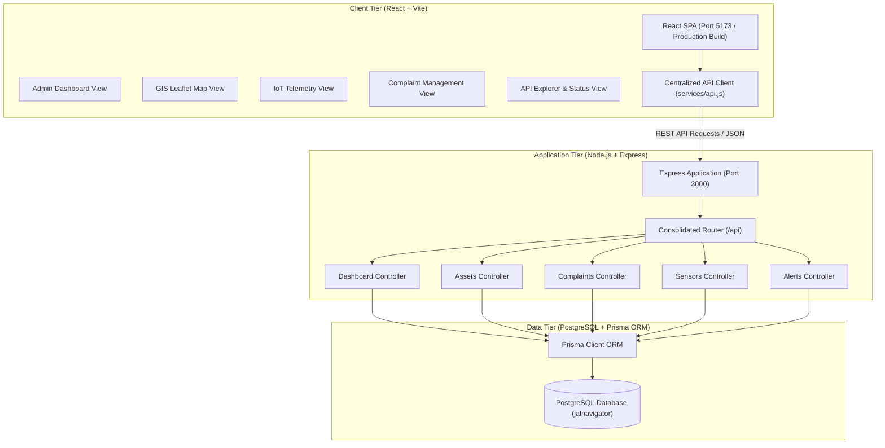
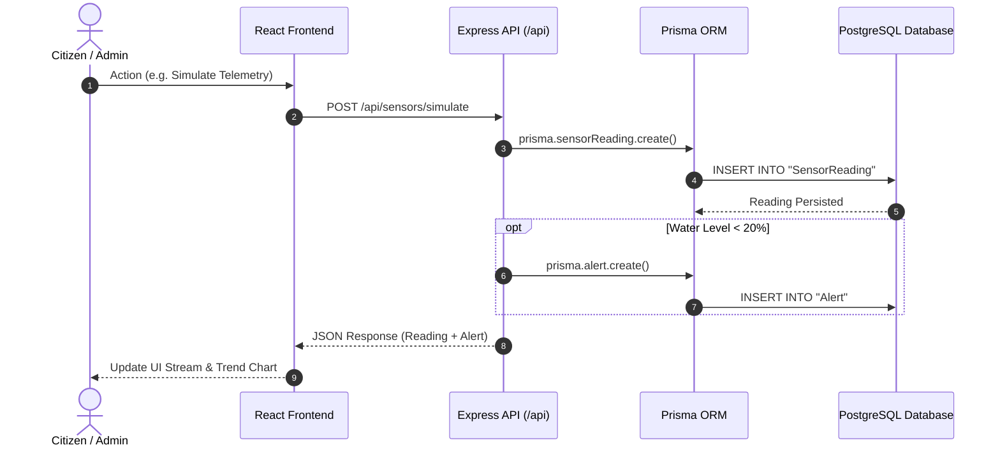

# System Architecture - JalNavigator

## 1. High-Level Architecture

JalNavigator is engineered as a decoupled full-stack web application designed for rural water supply mapping, IoT telemetry simulation, and citizen grievance management.

---

## 2. Component Structure

### Frontend Structure

- **`src/main.jsx`**: Application bootstrap, mounts React root with Leaflet styling.
- **`src/App.jsx`**: Primary layout containing the responsive sidebar navigation and tab switching.
- **`src/services/api.js`**: Centralized HTTP client wrapping all backend endpoints with standardized JSON parsing and error handling.
- **`src/components/Dashboard.jsx`**: High-level metrics, active alerts, and recent grievance stream.
- **`src/components/MapView.jsx`**: Leaflet GIS map with custom markers, coordinate picking, asset CRUD, and pipeline route rendering.
- **`src/components/Monitoring.jsx`**: IoT telemetry simulator, historical water level SVG chart, threshold breach alerts, and alert resolution.
- **`src/components/Complaints.jsx`**: Public grievance submission form, status filtering, and workflow state transitions.
- **`src/components/ApiExplorer.jsx`**: Built-in REST API testing console and health monitor.

### Backend Structure

- **`server.js`**: Initializes Express, CORS, static client asset serving, and mounts `/api`.
- **`database.js`**: Instantiates and exports singleton Prisma Client.
- **`routes/api.js`**: Master API router providing health metadata (`GET /api`) and aggregating submodule routes.
- **`routes/dashboard.js`**: Aggregates database statistics via concurrent Prisma count queries.
- **`routes/assets.js`**: CRUD operations on water infrastructure assets with cascade cleanup.
- **`routes/complaints.js`**: Grievance intake and status updates (`Pending`, `In Progress`, `Resolved`).
- **`routes/sensors.js`**: Telemetry recording, sensor simulation, and automated threshold alerts.
- **`routes/alerts.js`**: Alert listing and administrative resolution.
- **`prisma/schema.prisma`**: Relational data model definitions for PostgreSQL.
- **`prisma/seed.js`**: Sample village data populating assets, complaints, sensor readings, and alerts.

---

## 3. Data Flow

---

## 4. Operational Modes

### Development Mode
- Frontend runs via Vite dev server on `http://localhost:5173` with Hot Module Replacement (HMR).
- API requests are proxied automatically to `http://localhost:3000/api`.

### Production Mode
- Frontend is compiled into optimized static assets located in `frontend/dist`.
- Express backend serves the static bundle and handles all `/api/*` endpoints on `http://localhost:3000`.

