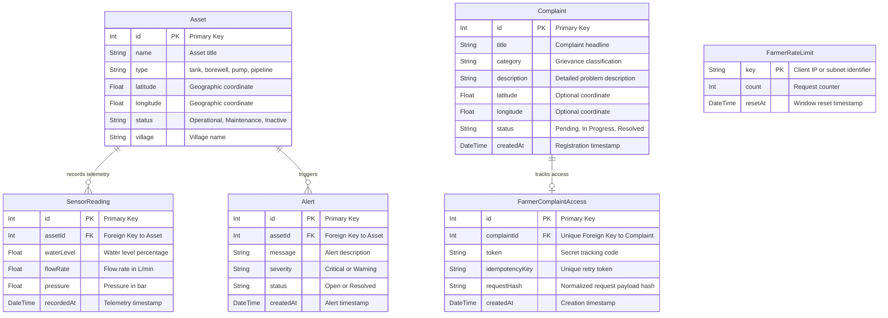

# Database & ER Modeling Specification

## Overview

JalNavigator uses PostgreSQL as its primary relational database managed via Prisma ORM. The schema models rural water supply infrastructure, simulated telemetry readings, anomaly alerts, and citizen grievances.

---

## Entity-Relationship (ER) Diagram



---

## Data Dictionary

### 1. `Asset` Model

Stores physical water supply assets deployed across rural habitations.

| Column | Type | Constraints | Description |
| :--- | :--- | :--- | :--- |
| `id` | `Int` | `PRIMARY KEY`, `AUTOINCREMENT` | Unique asset record identifier |
| `name` | `String` | `NOT NULL` | Descriptive name (e.g., Rampur Central Overhead Tank) |
| `type` | `String` | `NOT NULL` | Asset category: `tank`, `borewell`, `pump`, `pipeline` |
| `latitude` | `Float` | `NOT NULL` | Decimal degrees latitude coordinate |
| `longitude` | `Float` | `NOT NULL` | Decimal degrees longitude coordinate |
| `status` | `String` | `NOT NULL`, `DEFAULT('Operational')` | Operational state: `Operational`, `Maintenance`, `Inactive` |
| `village` | `String` | `NOT NULL` | Target village or administrative ward name |

**Relationships:**
- `sensorReadings`: One-to-many relationship with `SensorReading` (`Asset.id` -> `SensorReading.assetId`).
- `alerts`: One-to-many relationship with `Alert` (`Asset.id` -> `Alert.assetId`).

---

### 2. `Complaint` Model

Stores grievances submitted by citizens and villagers regarding water service disruptions.

| Column | Type | Constraints | Description |
| :--- | :--- | :--- | :--- |
| `id` | `Int` | `PRIMARY KEY`, `AUTOINCREMENT` | Unique complaint record identifier |
| `title` | `String` | `NOT NULL` | Summary headline of the water supply problem |
| `category` | `String` | `NOT NULL` | Grievance type: `Pipeline leakage`, `No water supply`, `Dirty water`, etc. |
| `description` | `String` | `NOT NULL` | Full issue description and locality details |
| `latitude` | `Float` | `NULLABLE` | Latitude where the problem was reported |
| `longitude` | `Float` | `NULLABLE` | Longitude where the problem was reported |
| `status` | `String` | `NOT NULL`, `DEFAULT('Pending')` | Workflow state: `Pending` -> `In Progress` -> `Resolved` |
| `createdAt` | `DateTime` | `NOT NULL`, `DEFAULT(now())` | Submission timestamp |

---

### 3. `SensorReading` Model

Stores simulated IoT telemetry readings capturing water level, flow rates, and network pressures.

| Column | Type | Constraints | Description |
| :--- | :--- | :--- | :--- |
| `id` | `Int` | `PRIMARY KEY`, `AUTOINCREMENT` | Unique telemetry reading identifier |
| `assetId` | `Int` | `FOREIGN KEY(Asset.id)`, `NOT NULL` | Associated infrastructure asset |
| `waterLevel` | `Float` | `NOT NULL` | Tank or storage reservoir capacity (0 - 100%) |
| `flowRate` | `Float` | `NOT NULL` | Volumetric delivery flow rate (L/min) |
| `pressure` | `Float` | `NOT NULL` | Water pipeline pressure (bar) |
| `recordedAt` | `DateTime` | `NOT NULL`, `DEFAULT(now())` | Measurement timestamp |

---

### 4. `Alert` Model

Stores threshold abnormality events triggered by automated telemetry analysis.

| Column | Type | Constraints | Description |
| :--- | :--- | :--- | :--- |
| `id` | `Int` | `PRIMARY KEY`, `AUTOINCREMENT` | Unique alert event identifier |
| `assetId` | `Int` | `FOREIGN KEY(Asset.id)`, `NOT NULL` | Associated infrastructure asset |
| `message` | `String` | `NOT NULL` | Threshold breach notification text |
| `severity` | `String` | `NOT NULL` | Abnormality grade: `Critical`, `Warning` |
| `status` | `String` | `NOT NULL`, `DEFAULT('Open')` | State: `Open` or `Resolved` |
| `createdAt` | `DateTime` | `NOT NULL`, `DEFAULT(now())` | Event creation timestamp |

---

### 5. `FarmerComplaintAccess` Model

Stores secure tracking codes and idempotency metadata for farmer grievance submissions.

| Column | Type | Constraints | Description |
| :--- | :--- | :--- | :--- |
| `id` | `Int` | `PRIMARY KEY`, `AUTOINCREMENT` | Unique access record identifier |
| `complaintId` | `Int` | `UNIQUE`, `FOREIGN KEY(Complaint.id)`, `ON DELETE CASCADE` | Associated complaint identifier |
| `token` | `String` | `NOT NULL` | 32-character tracking token |
| `idempotencyKey` | `String` | `UNIQUE`, `NULLABLE` | Client idempotency key for safe retries |
| `requestHash` | `String` | `NULLABLE` | SHA256 hash of cleaned request payload |
| `createdAt` | `DateTime` | `NOT NULL`, `DEFAULT(now())` | Creation timestamp |

---

### 6. `FarmerRateLimit` Model

Tracks rate limits for public citizen complaint endpoints.

| Column | Type | Constraints | Description |
| :--- | :--- | :--- | :--- |
| `key` | `String` | `PRIMARY KEY` | Client IP address or IPv6 subnet hash |
| `count` | `Int` | `NOT NULL` | Submission count in active window |
| `resetAt` | `DateTime` | `NOT NULL` | Timestamp when limit window resets |

---

## Prisma Schema Definition

The database schema is defined in `backend/prisma/schema.prisma`:

```prisma
generator client {
  provider = "prisma-client-js"
}

datasource db {
  provider = "postgresql"
  url      = env("DATABASE_URL")
}

model Asset {
  id             Int             @id @default(autoincrement())
  name           String
  type           String
  latitude       Float
  longitude      Float
  status         String
  village        String
  sensorReadings SensorReading[]
  alerts         Alert[]
}

model Complaint {
  id          Int      @id @default(autoincrement())
  title       String
  category    String
  description String
  latitude    Float?
  longitude   Float?
  status      String   @default("Pending")
  createdAt   DateTime @default(now())
  @@index([createdAt])
  farmerAccess FarmerComplaintAccess?
}

model SensorReading {
  id         Int      @id @default(autoincrement())
  assetId    Int
  waterLevel Float
  flowRate   Float
  pressure   Float
  recordedAt DateTime @default(now())
  asset      Asset    @relation(fields: [assetId], references: [id])
  @@index([recordedAt])
  @@index([assetId, recordedAt])
  @@index([assetId, recordedAt(sort: Desc), id(sort: Desc)])
}

model Alert {
  id        Int      @id @default(autoincrement())
  assetId   Int
  message   String
  severity  String
  status    String   @default("Open")
  createdAt DateTime @default(now())
  asset     Asset    @relation(fields: [assetId], references: [id])
  @@index([createdAt])
  @@index([assetId, createdAt])
}

model FarmerComplaintAccess {
  id             Int       @id @default(autoincrement())
  complaintId    Int       @unique
  token          String
  idempotencyKey String?   @unique
  requestHash    String?
  createdAt      DateTime  @default(now())
  complaint      Complaint @relation(fields: [complaintId], references: [id], onDelete: Cascade)
}

model FarmerRateLimit {
  key     String   @id
  count   Int
  resetAt DateTime

  @@index([resetAt])
}
```

---

## Database Management Commands

```bash
npx prisma db push
npx prisma studio
npm run seed
```

